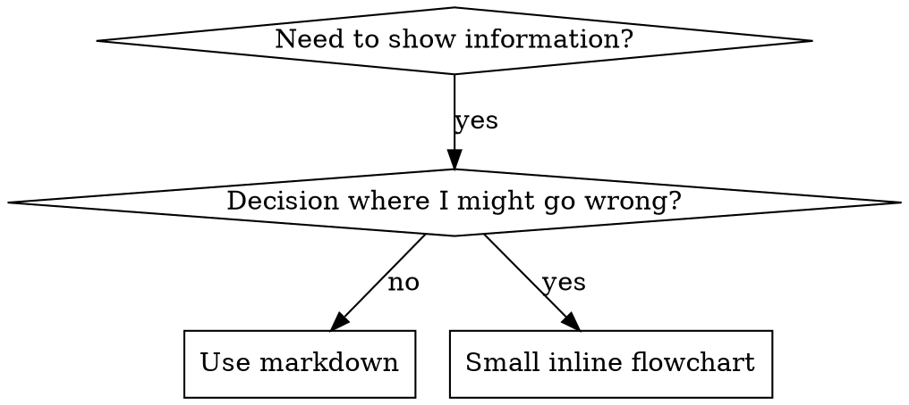

# Flowcharts in Agents

Part of [writing-agents](../../writing-agents.agent.md).



**Use flowcharts for:** non-obvious decisions, loops where the agent might stop
too early, or choosing between workflows. Use tables for references, code blocks
for examples, and numbered lists for linear instructions. Name nodes by their
meaning rather than `step1` or `helper2`.

See [graphviz-conventions.dot](graphviz-conventions.dot) for style rules.

Use [render-graphs.js](../render-graphs.js) through Node to render an Agent file's
DOT blocks. Graphviz (`dot`) must be installed. Run from the workspace and pass
the actual agent file path; outputs go under the workspace's `diagrams/` folder.

```bash
node <agent-root>/writing-agents/render-graphs.js <agent-root>/subagent-driven-development.agent.md
node <agent-root>/writing-agents/render-graphs.js <agent-root>/subagent-driven-development.agent.md --combine
```
